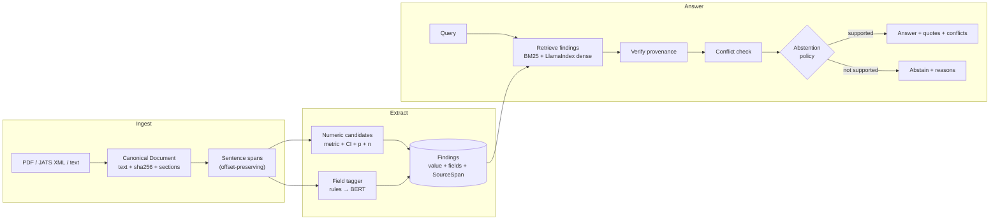

# EvidenceTrace-RAG

**Verifiable scientific evidence extraction.** A research assistant that pulls quantitative findings out of
papers, traces every number back to the exact characters it came from, flags findings that disagree, and
says "I can't answer that from this corpus" when the evidence isn't there.

`Python · LlamaIndex · BERT · RAG · NLP · Evaluation`

```
Q: What is the effect of Drug Zeta on systolic blood pressure compared with placebo?
STATUS: CONFLICTING  (confidence 1.00)
3 verified finding(s) from 3 paper(s). 2 conflict(s) detected between them.

  [2] Drug Zeta vs placebo -> systolic blood pressure
      MD -8.2 mmHg (95% CI -10.1 to -6.3, p<0.001, n=412)
      source: paper_a:628-760  (section: results)
      "Drug Zeta reduced systolic blood pressure compared with placebo (mean difference
       −8.2 mmHg, 95% CI −10.1 to −6.3; p<0.001; n = 412)."
  [3] ... MD -2.1 mmHg (95% CI -5 to 0.8, p=0.15, n=96) ...   source: paper_c:368-517

  ! MAGNITUDE (medium) between [2] and [3]
    Drug Zeta / systolic blood pressure: confidence intervals do not overlap. ...

Q: What is the effect of Drug Zeta on stroke?
STATUS: ABSTAINED  (confidence 0.00)
Abstained: related findings exist, but none covers the specific intervention/outcome/population asked about
(the closest findings never mention: stroke).
```

(The corpus in `data/samples/` is **synthetic** — a fictional drug and fictional trials built to contain
specific traps. The `confidence` is a transparent heuristic (0.35 + 0.25·has-CI + 0.10·has-p + 0.30·field-confidence,
halved for cited findings, scaled by retrieval coverage), **not** a calibrated probability. See
[Status](#status--honest-limitations).)

## Four guarantees (and what each one does not promise)

| | Guarantee | Enforced by |
|---|---|---|
| **Extract** | Effect sizes (HR/OR/RR/IRR/MD/SMD/RD) with CI, p-value, n, and who-vs-whom (intervention, comparator, outcome, population) | `extraction/` — regex numeric layer + swappable field tagger (rules → BERT) |
| **Trace** | Every number in an answer is checked against the exact sentence it came from, at answer time | `verification/provenance.py` — the document hash is recomputed from the text, `text[start:end] == quote`, every value/CI/p/n occurs in the span, and re-reading the span yields the same estimate (metric, value, CI, p). It proves the number is in the quoted sentence *in the right slot*. It does **not** prove the sentence supports the claim: a number about another arm or outcome in the same sentence still passes. |
| **Check** | Findings that answer the same question but disagree are surfaced, not averaged away | `verification/conflicts.py` — direction / magnitude / significance, ratios compared on the log scale. Tested on 5 synthetic papers only; it has **never fired on real papers** because the rule field tagger is too weak. |
| **Abstain** | No supporting finding → no answer, with machine-readable reasons | `abstention/policy.py` + a rarity-weighted *coverage* signal from retrieval. The signal is lexical, scoped to the estimate's clause and aware of reference arms ("vs placebo"); it is not a parser, and it is conservative, refusing most paraphrases. |

## How it works



Design principles (details in [docs/architecture.md](docs/architecture.md)):

1. **The unit of retrieval is a Finding, not a chunk.** Users want "a quantitative result about X". It also
   makes "nothing in the corpus is about X" a checkable statement.
2. **Numbers are copied, never generated.** An answer is assembled from verified Findings. Nothing in the
   answer path asks a model to write a number.
3. **Verification doesn't trust the extractor.** It re-derives each number from the canonical text, so a
   BERT/LLM extractor that "normalises" or hallucinates a value is caught.
4. **Abstention is an output with reasons**, not an exception: `low_coverage`, `unverified_provenance`,
   `low_confidence`, `insufficient_support`, `unresolved_conflict`.
5. **Every stage is evaluated on its own** — extraction, attribution, conflicts, abstention — because an
   end-to-end accuracy number can't tell you which stage failed.
6. **"Cited" ≠ "found".** An introduction that says "Hartmann et al. reported HR 0.55" is not this paper's
   result. Cited findings are tagged and excluded by default.

## Where LlamaIndex and BERT fit

| Component | Role | Module |
|---|---|---|
| **LlamaIndex** | Dense chunk index. Nodes are built from *our* sentence-aligned chunks with `start_char_idx`/`end_char_idx` set from the canonical text, so LlamaIndex never decides offsets and a hit maps to findings by plain containment. Fused with BM25 via RRF. | `retrieval/llama_index_store.py`, `retrieval/hybrid.py` |
| **BERT (field tagger)** | Token classification (BIO: INT/CMP/OUT/POP) replacing the rule baseline. Output text is copied from the sentence by offsets, never from the model's detokenised string. | `extraction/bert_tagger.py`, `scripts/train_field_tagger.py` |
| **BERT-family NLI (optional)** | Semantic check that the span *entails* the structured claim — catches what string matching can't (subgroup numbers, negation). | `verification/entailment.py` |

Both are optional extras; the deterministic core (numbers, provenance, conflicts, abstention, evaluation)
runs with only `pydantic`. **Neither has been run with real model weights**: the LlamaIndex path is tested with a mock
embedding, and `BertFieldTagger`, `NLIVerifier` and the training script are unexercised code.

## Quickstart

Requires **Python 3.11 or newer** (CI runs 3.11, 3.12 and 3.13).

```bash
python3 -m venv .venv && source .venv/bin/activate && pip install -U pip
pip install -e ".[dev]"          # core + tests
make test                        # 285 tests: 2 are strict xfails recording known limits; 1 needs the .[llama] and 4 the .[pdf] extra
make demo                        # ingest the synthetic corpus, ask two questions
make eval                        # per-stage evaluation on the synthetic corpus -> reports/eval.{md,json}
```

Reproduce the real-paper numbers (network once, ~22 MB of CC BY papers, SHA-256 verified; `make reproduce` runs all four steps):

```bash
make fetch-pinned                # exactly the 111 + 55 papers in data/m1/*_manifest.jsonl -> data/raw/ (git-ignored)
make verify-freeze               # every hash recorded in data/m1/FROZEN.json, recomputed
make m1-frozen                   # the held-out numbers, from the frozen source; diffs against data/m1/results
make m1 independent              # current code; independent-annotation scores; diffs against the committed files
make design by-design hardneg    # study design, extraction by design, hard-negative scores (one NCBI request)
```

Nothing in `make reproduce` overwrites a tracked file: outputs go to `reports/` and are diffed. `make fetch-new`
discovers *new* papers (PubMed's ranking drifts, so that path is not reproducible and is not used by the above).

```bash
evidencetrace ingest path/to/papers/ --workspace .evidencetrace     # .txt .md JATS .xml (.pdf with [pdf])
evidencetrace ask "Does X reduce Y?" --workspace .evidencetrace [--json]
evidencetrace inspect f_1a2b3c4d5e6f --workspace .evidencetrace     # a finding's span, in context
```

Optional extras: `.[llama]` (dense retrieval), `.[bert]` (tagger/NLI/training), `.[pdf]` (PyMuPDF).
Switch backends by editing `configs/default.toml` (`tagger = "bert"`, `backend = "hybrid"`) **and passing it:
`--config configs/default.toml`** - the CLI uses built-in defaults unless `--config` is given.

## Repo layout

```
src/evidencetrace/
  errors.py             IngestError (unusable input: reported as one line, not a traceback)
  schemas.py            Finding, SourceSpan, Conflict, Answer ... (the data contracts)
  config.py  textnorm.py  abbreviations.py  store.py  pipeline.py  render.py  cli.py
  ingest/               parsers (txt / structure-aware JATS / PDF), canonical Document, sentence spans,
                        chunking, pmc.py (licence-filtered PMC acquisition)
  extraction/           candidates.py (numbers) · fields.py (rules) · bert_tagger.py · extractor.py
  retrieval/            lexical.py (BM25 + coverage + rare-term gate) · hybrid.py (RRF) · llama_index_store.py
  verification/         provenance.py · conflicts.py · entailment.py (optional NLI)
  abstention/           policy.py
  evaluation/           gold.py · metrics.py · runner.py (synthetic) · m1.py · m1_queries.py (real papers)
configs/                default.toml (frozen behaviour) · posthoc.toml (paper-level rarity)
data/samples/           synthetic papers + gold            data/m1/   real-paper annotation, gold, results,
                                                                       independent blind annotation, freeze record
docs/                   architecture · evaluation · m1-report · known-issues · annotation-guidelines · roadmap
scripts/                fetch_pmc · make_candidates · build_gold · make_queries · run_m1 · verify_freeze · make_attribution
                        make_blind_inputs · validate_annotations · predict_papers · score_blind · train_field_tagger
tests/                  285 tests
```

## Evaluation

`make eval` scores each stage separately — extraction P/R/F1 and field token-F1, span-attribution accuracy,
verification pass rate, conflict P/R/F1 by kind, and for abstention: false-answer rate, over-abstention
rate, coverage/selective accuracy and AURC. Metric definitions, public datasets to use, the annotation
protocol and the ablation plan are in [docs/evaluation.md](docs/evaluation.md).

## Status & honest limitations

**Early research code (alpha).** The deterministic core works and is tested; the learned components are unexercised;
the real-data numbers come with serious caveats. Everything below is detailed in [docs/m1-report.md](docs/m1-report.md)
and [docs/known-issues.md](docs/known-issues.md); read them before quoting a figure.

### First real-data results (M1)

111 CC BY open-access papers from PubMed Central (cardiometabolic, 2019-2026), split by PMCID hash before any code ran;
code frozen (hash recorded, snapshot reproduces the numbers) before the test split was audited. **The query asked for
randomized trials, but PubMed labels only 67 of the 111 papers as trials** (the rest: 16 evidence syntheses, 8 observational,
3 protocols, 1 economic evaluation, 16 untyped journal articles). Extraction accuracy turned out to be the same for both groups
([report §2.1.1](docs/m1-report.md)).

| held-out test split (48 papers, 360 gold findings) | |
|---|---|
| value + CI extraction vs one LLM annotator's gold: precision / recall / F1 | 0.963 / 0.950 / **0.957** (95% CI for F1: 0.916-0.988) |
| results labelled "own" that are really another study's | **3 / 310 (1.0%)** |
| unanswerable queries that got an answer | **3 / 43 (7.0%)**: exact 95% upper bound 19%; the 29 cross queries alone 3 / 29 (10%); one of the three is a label error; all three are one drug from one paper |
| "effect of **placebo** on X" queries (the reference arm asked about as if it were the intervention) | the frozen system **answered 15 / 17 (dev) and 17 / 18 (test)**; after the role-aware retrieval fix 0 / 17 and 2 / 18, but that fix was developed on these queries |
| answerable queries refused | **35%** (86% of hand-written paraphrases) |
| conflicts detected on real papers | **0** (the rule tagger fills any field for ~10% of findings) |

### Independent check: five blind LLM annotators, 30 papers the system never saw

The frozen system was scored against annotations made without seeing its output
([data/m1/independent/](data/m1/independent/README.md)).

| | F1 (value + CI) |
|---|---|
| all 30 unseen papers | **0.742** [0.609, 0.865] (P 0.859, R 0.653) |
| 15 cardiometabolic papers (the domain M1 was built on) | **0.902** |
| 15 other-domain papers | **0.477** |

So the 0.957 above describes cardiometabolic trials phrased the way the regexes were fitted to; it is **not** the
system's general accuracy. Fixes made after seeing these papers raise their F1 to 0.865, but that number is tuned on
them. A second blind round on **25 papers nobody had seen** (predictions frozen and pushed first) scores **F1 0.823**
(precision 0.95, recall 0.72), and the fixes changed none of its predictions. Pooling both rounds, the frozen system's
out-of-sample F1 on **55 unseen papers is 0.785 [0.707, 0.849]**.

What this means: number extraction, the provenance check and (for drugs the corpus never pairs with the asked outcome
in one sentence) wrong-drug protection work on cardiometabolic trial text; **entity/field tagging does not** (so
conflict detection is dormant), retrieval is lexical (it now tracks clauses and reference arms, but only heuristically),
and recall falls sharply outside the domain it was built on.

**Threats to validity (the short version).** Every annotation here was made by an LLM. The only human judgement is the repository owner's adjudication of the 158 system-vs-annotator disagreements (above): a single adjudicator, disagreements only, and the M1 gold (developer = annotator) has no human check.
The M1 gold standard is a single annotator who is also the developer; it is pooled from the system's own output
(precision is flattering), dev numbers are fitted, post-hoc columns are not held-out, the same clinical trials appear on
both sides of the split, and several headline metrics (provenance pass rate, value+CI vs value-only, span attribution)
are consistency checks that cannot fail the way an extractor fails. The independent annotators are also LLM agents.

**Adjudication.** All 158 places where the system and the blind annotators disagreed were judged on
[the review page](https://callmesobhan.github.io/evidencetrace-rag/adjudication.html) (verdicts and notes:
[data/m1/independent/adjudication/](data/m1/independent/adjudication/README.md)). Applying them, the frozen system's F1 on the 55 unseen papers is
**0.837 [0.786, 0.884]** instead of 0.785: 22 of the 129 annotator-only "misses" were annotator over-inclusion, and 17 of the 29 system-only
"false positives" were real estimates. This corrects only the disagreements (an estimate both sides missed stays invisible), it is a single
adjudicator (the repository owner, by their own statement; qualifications not recorded), so the caveats below still apply.

### What is verified, and what is not

**Verified by the test suite** (`make test`): numeric extraction across dozens of reporting formats seen in real papers (including covariate-balance SMDs, which are not effects),
offset-exact provenance and tamper detection (including swapped intervals and flipped operators), all three conflict
kinds (on synthetic data), the abstention ladder, own-vs-cited logic, structure-aware JATS parsing, abbreviation
expansion, the rare-term gate, the LlamaIndex index (mock embedding), CLI error handling, hash verification of the
freeze record, and the evaluation machinery. Two known limitations are recorded as strict `xfail` tests.

**Reproducibility.** `make reproduce` re-derives every committed number (including study design and the hard-negative scores) from SHA-256-pinned downloads and diffs it
against the committed files; the results are byte-identical on Python 3.11 and 3.13 (verified).

**Written but never run against real model weights**: `BertFieldTagger` with a real checkpoint, `NLIVerifier`,
`HuggingFaceEmbedding`, `scripts/train_field_tagger.py`'s training loop, the PDF parser.

**Known gaps** (full list in [docs/known-issues.md](docs/known-issues.md)): unnamed estimates ("increased X by 7.3 g/L
(95% CI…)") and unusual notations (`COR/p = 6.30/0.01`) are out of scope or unrecognised; no table or figure extraction;
Results sentences that don't name the intervention can't be answered lexically; role handling in retrieval is heuristic (a
control word in another sense, "active control", still leaks, and `but`/`although` are not clause boundaries); a heart rate
written `HR 72 (95% CI 70-74)` with no unit is read as a hazard ratio.

See [docs/roadmap.md](docs/roadmap.md) for the plan.

## License

Code and original annotations: [MIT](LICENSE), copyright Sobhan Shahbazi. The quoted sentences in `data/m1/` come from 166
CC BY articles and keep their authors' licence and attribution requirement: see [data/m1/ATTRIBUTION.md](data/m1/ATTRIBUTION.md).
